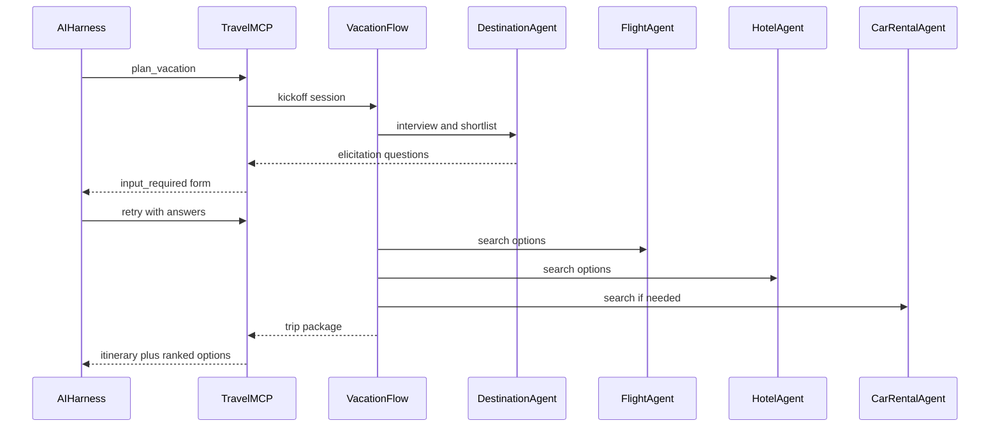
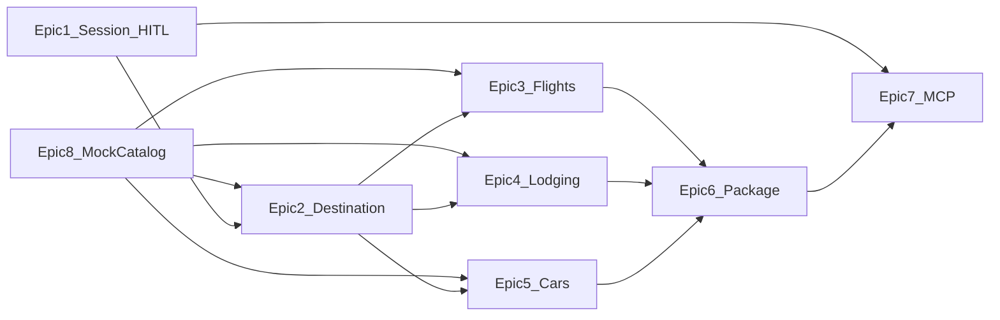

# Product Requirements Document: Vacation Planner Agent

| Field | Value |
| --- | --- |
| Product name | Vacation Planner Agent |
| Code name | Travel Agent |
| Version | 1.0 (draft) |
| Status | Approved for documentation; implementation not started |
| Owner | Product / PM agent |
| Primary interface | Model Context Protocol (MCP) |
| Orchestration | CrewAI Flows + specialist Crews |
| Date | 2026-11-07 |
| Folder | `travel-agent/` only |

This document is the source of truth for v1 of the Vacation Planner Agent. All implementation for this product lives under `travel-agent/`. Existing files elsewhere in this repository are out of scope.

---

## 1. Executive summary

Vacation Planner Agent is a multi-agent travel planner that interviews a traveler, proposes destinations, and assembles a comparable package of flights, lodging, and (when needed) rental cars. People use it from any MCP-capable AI harness — Cursor, Claude Desktop, ChatGPT, and similar — not from a dedicated web app.

v1 **plans and searches**. The four “booking” agents search, rank, and return bookable options (deep links and structured booking payloads). They do not take payment, store card data, issue tickets, or confirm reservations. Paid checkout is a later phase.

The product succeeds when a traveler can go from a vague idea (“beach weekend with kids, not too expensive”) to a structured trip package — destination shortlist, day outline, ranked flight/hotel/car options — with a small number of explicit questions and no web UI.

---

## 2. Vision, problem, and goals

### 2.1 Vision

A traveler talks to the AI harness they already use. The planner asks only what it still needs, proposes two or three destinations that match the trip style, then coordinates specialist agents so flight, stay, and car options land in one itinerary the harness can keep using.

### 2.2 Problem

Vacation planning is split across airline sites, hotel sites, maps, and park pages. Chat-only assistants guess missing constraints, hallucinate inventory, or dump unstructured prose. Travelers need:

- Structured questions instead of open-ended chat ping-pong
- Destination ideas that respect trip type (beach, mountain, lake, cabin, state parks)
- Side-by-side options for flights, lodging, and cars
- A single trip artifact they can revise

### 2.3 Product goals

| ID | Goal | How we know |
| --- | --- | --- |
| G1 | Reduce planning round-trips | Median elicitation rounds per completed plan ≤ 3 |
| G2 | Ask structured HITL questions, not vague chat | Every required field has an enum or schema; unanswered required fields block a “complete” package |
| G3 | Return comparable option sets | A complete package includes ≥ 3 flight options and ≥ 3 lodging options; car options when required |
| G4 | One itinerary artifact | `get_trip` and `trip://{session_id}` return the same canonical package |
| G5 | Work from any MCP harness | stdio + streamable HTTP; elicitation with a `needs_input` fallback |

### 2.4 Non-goals (v1)

See [section 12](#12-out-of-scope) for the full list. In short: no web UI, no payments, no live GDS requirement, no visa/insurance, no first-class multi-city open-jaw product.

---

## 3. Locked product decisions

These decisions are locked for v1 unless a later PRD revision changes them.

1. **Plan + search + option packages, not paid booking.** Agents named “booking” search and rank. They never charge a card or confirm a PNR/reservation.
2. **MCP-only interface.** No web UI in v1. Architecture must not block a later UI on the same Flow and session model.
3. **HITL via MCP elicitation (form mode).** Destination type, activities, trip style, dates, origin, party, budget, car need. Clients that cannot elicit receive structured `needs_input` tool results.
4. **US-first destinations.** Beaches, mountains, lakes, cabins, and popular state parks in the United States. International is a later phase.
5. **Provider adapters with mock catalogs in v1.** Orchestration ships against fixtures. Live providers (Amadeus, Duffel, hotel/car APIs) are Phase 2.
6. **CrewAI Flows orchestrate specialist Crews.** One Vacation Flow; four agents (destination, flights, hotels, cars).

---

## 4. Users, personas, and jobs-to-be-done

v1 has no authenticated product account. The “user” is the person talking to the host harness. The MCP server sees whatever the harness forwards (prompt text, tool args, elicitation answers). Do not assume OAuth identity in v1.

### 4.1 Maya — independent traveler

- Plans a long weekend from Cursor or Claude while working.
- Knows origin city and rough month; unclear on destination type.
- Wants a short interview, two destination ideas, and bookable flight + hotel links.
- Job: “Turn a vague weekend idea into a package I can actually book myself.”

### 4.2 Jordan — family planner

- Planning with kids, a budget band, and a bias toward cabins or state parks.
- Needs family-friendly lodging, a car for park access, and activities that are not nightlife-first.
- Job: “Find a park or cabin trip that fits school dates and a real budget.”

### 4.3 Sam and Alex — couple, style undecided

- Debating sightseeing vs rest. Willing to be asked.
- Care about neighborhood/vibe more than the cheapest fare.
- Job: “Help us pick a style, then a place, then a stay that matches that style.”

### 4.4 Riley — power user

- Already knows dates, origin airport, and destination.
- Wants specialist search only: flights, hotels, or cars, then lock choices into a package.
- Job: “Skip the interview. Give me ranked options and let me select.”

### 4.5 Anti-personas (v1)

- Travel-agency operations staff needing PNR queues, commissions, or GDS workbenches
- Users who need the system to complete paid checkout
- International multi-country itineraries as the primary job

---

## 5. Experience: MCP + human-in-the-loop

### 5.1 End-to-end flow



### 5.2 Session lifecycle

| Status | Meaning | Allowed tools |
| --- | --- | --- |
| `intake` | Session created; required profile fields missing | `plan_vacation`, `get_trip` |
| `shortlisting` | Profile complete; destination agent proposing 2–3 options | `plan_vacation`, `get_trip`, `revise_trip` |
| `destination_selected` | Traveler (or auto-pick rule) locked a destination | specialist searches, `revise_trip` |
| `options_ready` | Flight + lodging (and car if required) option sets present | `select_option`, `get_trip`, `revise_trip` |
| `packaged` | At least one option selected per required category, or traveler accepted ranked defaults | `get_trip`, `revise_trip`, `select_option` |
| `abandoned` | Traveler declined/cancelled intake and did not resume | `plan_vacation` to reopen, `get_trip` |

A session is identified by `session_id` (UUID). If the harness omits it, `plan_vacation` creates one and returns it. Subsequent calls should pass it back.

### 5.3 HITL catalog

Ask **only missing fields**. Never re-ask a field that is already set unless `revise_trip` invalidates it. Multi-select is allowed where noted.

#### Required for a complete destination shortlist

| Field | Type | Values / format | Notes |
| --- | --- | --- | --- |
| `destination_types` | enum[], min 1 | `beach`, `mountain`, `lake`, `cabin`, `state_park` | Cabin may combine with lake/mountain/park |
| `trip_style` | enum | `sightseeing`, `rest`, `mixed` | “Is this a sightseeing trip?” maps here |
| `origin` | string | City or IATA (e.g. `Austin` or `AUS`) | Normalize to airport code when possible |
| `date_mode` | enum | `fixed`, `flexible` | |
| `start_date` / `end_date` | date | ISO `YYYY-MM-DD` | Required when `date_mode=fixed` |
| `earliest_start` / `latest_end` / `nights` | date / date / int | | Required when `date_mode=flexible` |
| `party_size` | int ≥ 1 | | |
| `budget_band` | enum | `value`, `moderate`, `premium`, `unspecified` | |

#### Required or inferred before packaging

| Field | Type | Values | Skip / infer rules |
| --- | --- | --- | --- |
| `want_activities` | bool | | If omitted, default `true` when `trip_style` is `sightseeing` or `mixed` |
| `activity_types` | enum[] | `hiking`, `water_sports`, `food`, `nightlife`, `museums`, `family`, `scenic_drives`, `wildlife` | Skip if `want_activities=false` |
| `need_car` | enum | `yes`, `no`, `unsure` | Infer `yes` for `cabin` or `state_park` when origin is not the destination metro; infer `no` for dense urban beach/city with airport hotel |
| `lodging_style` | enum[] | `hotel`, `cabin`, `park_lodge`, `vacation_rental`, `any` | Default from `destination_types` (`cabin` → cabin/vacation_rental; `state_park` → park_lodge/cabin) |

#### Optional (ask only if the traveler volunteers or a specialist is blocked)

| Field | Type | Values | Notes |
| --- | --- | --- | --- |
| `child_ages` | int[] | 0–17 | Ask if `party_size` > 1 and family activities selected |
| `pace` | enum | `relaxed`, `moderate`, `packed` | |
| `climate_preference` | enum | `warm`, `cool`, `any` | |
| `accessibility_needs` | string | free text, short | Do not require |
| `must_haves` / `must_avoids` | string[] | | e.g. “nonstop only”, “no red-eyes” |
| `preferred_airlines` | string[] | | Power-user path |
| `max_budget_usd` | number | | Overrides band if provided |

#### Example elicitation form (destination intake)

Message: “A few choices so we can pick a destination and search real options.”

```json
{
  "mode": "form",
  "message": "Tell us how you want this trip to feel.",
  "requestedSchema": {
    "type": "object",
    "properties": {
      "destination_types": {
        "type": "array",
        "minItems": 1,
        "items": {
          "type": "string",
          "enum": ["beach", "mountain", "lake", "cabin", "state_park"]
        },
        "description": "What kind of place? Select all that apply."
      },
      "trip_style": {
        "type": "string",
        "enum": ["sightseeing", "rest", "mixed"],
        "description": "Sightseeing, rest/relax, or mixed?"
      },
      "want_activities": { "type": "boolean" },
      "activity_types": {
        "type": "array",
        "items": {
          "type": "string",
          "enum": ["hiking", "water_sports", "food", "nightlife", "museums", "family", "scenic_drives", "wildlife"]
        }
      }
    },
    "required": ["destination_types", "trip_style"]
  }
}
```

Dates, origin, party, and budget may be a second round if not present in the original `plan_vacation` arguments. Do not combine more than ~6 fields in one form.

### 5.4 Elicitation rules

1. Prefer MCP elicitation form mode (`resultType: "input_required"` / client retry with `inputResponses` and echoed `requestState`).
2. If the client does not support elicitation, return a normal tool result:

   ```json
   {
     "status": "needs_input",
     "session_id": "…",
     "message": "Please answer these so planning can continue.",
     "fields": [ { "id": "destination_types", "…": "…" } ]
   }
   ```

   The harness should call `plan_vacation` again with those fields filled.
3. **Accept:** merge answers into trip state; continue the Flow.
4. **Decline:** do not error. Produce a partial plan from known fields, mark missing required fields, status `intake` or `shortlisting` as appropriate, and explain what could not be completed.
5. **Cancel:** same as decline; leave session resumable.
6. Never request passwords, API keys, payment credentials, or government ID via form elicitation. Payment, if ever added, is URL-mode elicitation only (Phase 3).
7. `requestState` may contain a session id and a hash of known profile fields. It must not contain secrets. Treat every retry as a fresh process; persist session state in the store, not in the in-memory stack.

### 5.5 Power-user bypass

If `plan_vacation` or a specialist tool is called with origin, destination (or destination types plus a named place), dates, and party already set, skip destination interview. Still run destination agent only if a named destination is missing.

---

## 6. Agent model

### 6.1 Orchestration

One CrewAI **Vacation Flow** owns session state, HITL gates, and fan-out to specialist Crews. Specialists may run in parallel after a destination (or explicit search target) is known.

| Agent | CrewAI role | Goal | Inputs | Outputs |
| --- | --- | --- | --- | --- |
| Destination Planning (lead) | Vacation destination planner | Interview, shortlist 2–3 US destinations, draft a day-level outline | Traveler profile, HITL answers | `DestinationBrief[]`, recommended pick, activity outline, `need_car` recommendation |
| Flight booking | Flight search specialist | Find and rank flights | origin, dest airports, dates, party, budget, must-haves | Ranked `FlightOption[]` (min 3 when inventory exists) |
| Hotel booking | Lodging search specialist | Find and rank stays | dest, dates, party, lodging style, budget | Ranked `LodgingOption[]` (hotel, cabin, park lodge, vacation rental) |
| Car rental booking | Car search specialist | Find and rank cars, or skip | dest, dates, party, trip type, `need_car` | Ranked `CarOption[]` **or** `{ "needed": false, "reason": "…" }` |

Specialists do not interview the traveler except to request a single blocking field (for example a missing return date) through the Flow’s elicitation layer. They do not talk to the harness directly.

### 6.2 Destination ranking rubric (v1, mock catalog)

Score each candidate 0–100:

| Signal | Weight | Notes |
| --- | --- | --- |
| Destination type match | 30 | Intersection with `destination_types` |
| Activity overlap | 20 | Catalog tags vs `activity_types` |
| Trip style fit | 15 | Sightseeing density vs rest/quiet |
| Season / date fit | 15 | Fixture seasonality flags |
| Budget fit | 10 | Typical stay+car band vs `budget_band` |
| Travel time from origin | 10 | Fixture duration bands from origin airport |

Return the top 2 or 3. Include a one-paragraph rationale per destination. Do not invent parks, beaches, or airports that are not in the catalog.

### 6.3 Option ranking (flights, lodging, cars)

Each option carries `rank`, `total_usd`, `score_breakdown`, `deep_link` (may be a mock URL in v1), and `provider`. Default sort: best overall (price + duration + constraint fit), with the top option labeled `recommended`. Always include a cheaper alternative and a more convenient alternative when the catalog allows.

### 6.4 Shared trip state

Canonical Pydantic-style model (names are normative for implementation):

```text
TripSession
  session_id: UUID
  status: intake | shortlisting | destination_selected | options_ready | packaged | abandoned
  created_at, updated_at: datetime
  profile: TravelerProfile          # HITL fields in section 5.3
  open_questions: Question[]        # still missing
  shortlist: DestinationBrief[]     # 0–3
  selected_destination: DestinationBrief | null
  activity_plan: DayPlan[]          # day-level outline
  flight_options: FlightOption[]
  lodging_options: LodgingOption[]
  car_options: CarOption[]
  car_not_needed: { reason: str } | null
  selections: { flight_id?, lodging_id?, car_id? }
  package: TripPackage | null       # snapshot for get_trip
  notes: str[]                      # decline/partial explanations
```

Persistence: local store (SQLite or JSON files under `travel-agent/` runtime data). v1 is single-process / single-user per server instance unless configured otherwise.

---

## 7. MCP surface (v1 contract)

### 7.1 Server identity

- Server name: `vacation-planner`
- Title: Vacation Planner Agent
- Transports: **stdio** (local harness) and **streamable HTTP** (remote)
- Protocol: MCP with elicitation (form mode). Degrade to `needs_input` results when elicitation is unavailable.

### 7.2 Tools

#### `plan_vacation`

Start or continue a trip session. Primary entry point for Maya, Jordan, and Sam/Alex.

| Argument | Type | Required | Description |
| --- | --- | --- | --- |
| `session_id` | string | no | Resume an existing session |
| `request` | string | no | Free-text intent (“long weekend at a lake cabin”) |
| `origin` | string | no | City or IATA |
| `destination_types` | enum[] | no | See catalog |
| `trip_style` | enum | no | |
| `start_date` / `end_date` | date | no | |
| `party_size` | int | no | |
| `budget_band` | enum | no | |
| plus any other profile fields | | no | Merged if present |

**Behavior**

1. Create or load session.
2. Merge arguments into `profile`.
3. If required fields missing → elicit (or `needs_input`).
4. Run destination agent → shortlist.
5. If exactly one strong match or the traveler already named a place, auto-select; otherwise elicit a destination choice among the shortlist.
6. Fan out flight + lodging (+ car if needed).
7. Return `TripPackage` with `status`.

**Returns:** `TripPackage` **or** elicitation **or** `needs_input`.

#### `get_trip`

| Argument | Required |
| --- | --- |
| `session_id` | yes |

Returns the current session snapshot. If unknown, error `session_not_found`.

#### `revise_trip`

Change dates, destination, budget, party, types, or style. Invalidates downstream option sets that depend on the changed fields and re-runs the affected specialists.

| Argument | Required |
| --- | --- |
| `session_id` | yes |
| `changes` | yes — object of profile/destination fields to overwrite |
| `reason` | no |

If a change removes a required field, return to elicitation.

#### `search_flights` / `search_hotels` / `search_cars`

Specialist entry points for Riley (power user). May attach to `session_id` or run a one-shot search.

Shared arguments: `origin` and/or `destination` (IATA or place), `start_date`, `end_date`, `party_size`, `budget_band`, `session_id` (optional).

Hotel-specific: `lodging_style`. Car-specific: `need_car` (if `no`, return `car_not_needed` without searching).

If `session_id` is provided, write results onto that session. If not, return a standalone option set with a newly created session so the traveler can `select_option` later.

#### `select_option`

Lock a flight, lodging, and/or car into the package.

| Argument | Required |
| --- | --- |
| `session_id` | yes |
| `flight_id` | no |
| `lodging_id` | no |
| `car_id` | no |
| `clear_car` | no — set true if traveler opts out of a car |

Selecting an unknown id is an error. After required categories are selected (flight + lodging; car if `need_car=yes`), status becomes `packaged`.

### 7.3 Resources

| URI | MIME | Description |
| --- | --- | --- |
| `trip://{session_id}` | `application/json` | Canonical `TripPackage` |
| `trip://{session_id}/markdown` | `text/markdown` | Human-readable itinerary for the harness to display |

Resource reads are snapshots; they do not trigger new searches.

### 7.4 Errors

| Code | When |
| --- | --- |
| `session_not_found` | Unknown `session_id` |
| `invalid_dates` | End before start, nights < 1, dates in the past (allow same-day with warning) |
| `unknown_option` | `select_option` id not in current option sets |
| `catalog_empty` | Mock provider has no rows for the query — return empty list with explanation, not a crash |
| `provider_unavailable` | Adapter failure; include `retryable: true/false` |

Tool errors are structured JSON in the tool result (`isError` true only for unexpected failures). Validation misses should elicit or `needs_input`, not throw.

### 7.5 Harness configuration (illustrative)

**Cursor / Claude Desktop (stdio)**

```json
{
  "mcpServers": {
    "vacation-planner": {
      "command": "python",
      "args": ["-m", "travel_agent.mcp_server"],
      "env": {
        "OPENAI_API_KEY": "${OPENAI_API_KEY}"
      }
    }
  }
}
```

**Streamable HTTP** (later ops): `https://<host>/mcp` with optional bearer token from environment. v1 local-first does not require auth.

Exact module path may change when code is added; keep this snippet updated in the project README at implementation time.

---

## 8. Domain objects (normative shapes)

### 8.1 TripPackage (tool return)

```json
{
  "session_id": "550e8400-e29b-41d4-a716-446655440000",
  "status": "options_ready",
  "profile": { "origin": "AUS", "destination_types": ["state_park", "cabin"], "trip_style": "mixed" },
  "shortlist": [],
  "selected_destination": {
    "id": "dest_big_bend",
    "name": "Big Bend National Park area",
    "types": ["state_park", "mountain", "cabin"],
    "summary": "…",
    "rationale": "…",
    "nearest_airports": ["VCT", "ELP", "AUS"],
    "need_car": "yes"
  },
  "activity_plan": [
    { "day": 1, "title": "Arrive and scenic drive", "activities": ["scenic_drives"] }
  ],
  "flights": [],
  "lodging": [],
  "cars": [],
  "car_not_needed": null,
  "selections": {},
  "open_questions": [],
  "warnings": []
}
```

### 8.2 FlightOption

`id`, `carrier`, `origin`, `destination`, `depart_at`, `arrive_at`, `duration_minutes`, `stops`, `cabin`, `seats_left` (optional), `total_usd`, `per_person_usd`, `deep_link`, `provider`, `rank`, `recommended` (bool).

### 8.3 LodgingOption

`id`, `name`, `kind` (`hotel` | `cabin` | `park_lodge` | `vacation_rental`), `nights`, `check_in`, `check_out`, `nightly_usd`, `total_usd`, `location_label`, `family_friendly`, `deep_link`, `provider`, `rank`, `recommended`.

### 8.4 CarOption

`id`, `company`, `category` (`economy` | `suv` | `minivan` | `truck`), `pickup`, `dropoff`, `total_usd`, `deep_link`, `provider`, `rank`, `recommended`.

### 8.5 DestinationBrief

`id`, `name`, `state`, `types[]`, `summary`, `rationale`, `typical_nights`, `nearest_airports[]`, `need_car` (`yes` | `no` | `optional`), `activity_tags[]`, `budget_band_fit[]`.

---

## 9. Functional requirements and user stories

Story points are relative complexity for a later sprint plan, not calendar estimates. Priority: P0 must ship in v1; P1 should; P2 can slip.

### Epic 1 — Trip session and HITL interview

**Feature 1.1 Session lifecycle**

- **US-1.1.1** As a traveler, I want `plan_vacation` to create a session I can resume, so that follow-up answers attach to the same trip.
  - AC: Calling without `session_id` returns a new UUID; calling with it loads the same profile.
  - AC: `get_trip` with a bad id returns `session_not_found`.
  - Points: 3. Priority: P0. Owner: backend / MCP.

- **US-1.1.2** As a traveler, I want the planner to ask only missing questions, so that I am not re-interviewed.
  - AC: Fields present in the first tool call never appear in the first elicitation form.
  - AC: After accept, those fields persist across `get_trip`.
  - Points: 5. Priority: P0. Owner: Flow / HITL.

- **US-1.1.3** As a traveler, I want to decline or cancel a question without crashing the session, so that I can still get a partial plan.
  - AC: Decline/cancel → `status` remains resumable; `notes` explain what is missing; HTTP/tool is not `isError`.
  - Points: 3. Priority: P0. Owner: Flow / HITL.

- **US-1.1.4** As a harness without elicitation support, I want a `needs_input` payload, so that I can ask the user in chat and retry.
  - AC: Payload lists field ids, types, enums, and a human `message`.
  - AC: Retry of `plan_vacation` with those fields continues without duplicating the session.
  - Points: 5. Priority: P0. Owner: MCP.

**Feature 1.2 Interview catalog**

- **US-1.2.1** As a traveler, I want to choose destination types (beach, mountain, lake, cabin, popular state parks), so that shortlists match the trip I want.
  - AC: Multi-select; at least one required for shortlist.
  - Points: 2. Priority: P0.

- **US-1.2.2** As a traveler, I want to say whether I want nearby activities and which types, so that the day plan is not generic.
  - AC: `want_activities=false` skips `activity_types`; sightseeing/mixed defaults `want_activities=true`.
  - Points: 2. Priority: P0.

- **US-1.2.3** As a traveler, I want to declare sightseeing vs rest vs mixed, so that destination and lodging rank differently.
  - AC: `rest` down-ranks nightlife-heavy and packed sightseeing destinations in the mock catalog.
  - Points: 2. Priority: P0.

- **US-1.2.4** As a traveler, I want to provide origin, dates (fixed or flexible), party size, and budget band, so that search is possible.
  - AC: Invalid date ranges return `invalid_dates` with a fix prompt.
  - Points: 3. Priority: P0.

### Epic 2 — Destination discovery and ranking

- **US-2.1** As a traveler, I want 2–3 ranked US destinations with a rationale, so that I can pick one without researching from scratch.
  - AC: Each brief includes types, summary, rationale, airports, `need_car`, activity tags.
  - AC: Destinations come from the catalog; no invented place names.
  - Points: 8. Priority: P0. Owner: Destination agent.

- **US-2.2** As a traveler, I want a day-level activity outline after a destination is selected, so that the trip feels planned, not just booked.
  - AC: One entry per night+1 days; activities subset of requested types when `want_activities=true`.
  - Points: 5. Priority: P1. Owner: Destination agent.

- **US-2.3** As a traveler, I want to pick among the shortlist (HITL), so that the system does not lock a destination I dislike.
  - AC: Elicit destination id from shortlist unless a named destination was already provided or a power-user search was used.
  - Points: 3. Priority: P0.

- **US-2.4** As a family planner, I want cabin and state-park options to surface when I select those types, so that I am not only shown beach hotels.
  - AC: Fixture set includes ≥ 2 of each type: beach, mountain, lake, cabin-oriented, popular state park.
  - Points: 3. Priority: P0. Owner: catalog.

### Epic 3 — Flight option search

- **US-3.1** As a traveler, I want ranked flights for my origin, destination airports, dates, and party, so that I can compare price vs convenience.
  - AC: ≥ 3 options when the mock catalog has ≥ 3 rows; otherwise return all and warn.
  - AC: Each option has times, stops, duration, total and per-person price, deep link, rank.
  - Points: 5. Priority: P0. Owner: Flight agent.

- **US-3.2** As a power user, I want `search_flights` without a full vacation interview, so that I can shop a known route.
  - AC: Missing origin/dates elicit only those fields.
  - Points: 3. Priority: P1.

- **US-3.3** As a traveler, I want nonstop or max-stops preferences honored when I set must-haves, so that red-eyes and connections are not forced.
  - AC: Options violating hard must-haves are excluded or listed under `warnings` as non-compliant, never as `recommended`.
  - Points: 3. Priority: P1.

### Epic 4 — Hotel / lodging option search

- **US-4.1** As a traveler, I want ranked lodging that respects hotel vs cabin vs park lodge vs vacation rental, so that a cabin trip does not return only downtown hotels.
  - AC: Filter by `lodging_style`; `any` may mix kinds.
  - AC: ≥ 3 options when catalog allows.
  - Points: 5. Priority: P0. Owner: Hotel agent.

- **US-4.2** As a family planner, I want family-friendly flags and capacity vs party size, so that a 2-guest hotel room is not recommended for 5 people.
  - AC: Recommended lodging capacity ≥ `party_size` (rooms or listing occupancy).
  - Points: 3. Priority: P0.

- **US-4.3** As a traveler, I want lodging dates aligned to flight dates after flights are known, so that I do not have a hotel gap night.
  - AC: Default check-in = arrival date, check-out = departure date; warn if the traveler overrides.
  - Points: 3. Priority: P1.

### Epic 5 — Car rental option search

- **US-5.1** As a traveler going to a cabin or state park, I want the planner to assume I need a car unless I say otherwise, so that I am not stranded.
  - AC: Infer `need_car=yes` per section 5.3; run car search automatically.
  - Points: 3. Priority: P0. Owner: Flow + Car agent.

- **US-5.2** As a traveler who does not need a car, I want the package to say so and skip search, so that I am not shown irrelevant SUVs.
  - AC: `car_not_needed.reason` is human-readable; `cars` is empty.
  - Points: 2. Priority: P0.

- **US-5.3** As a traveler who needs a car, I want ≥ 3 ranked options with pickup aligned to arrival airport when possible.
  - Points: 5. Priority: P0.

### Epic 6 — Unified trip package

- **US-6.1** As a traveler, I want one package with destination, outline, and option sets, so that I do not stitch three chats together.
  - AC: `plan_vacation` final success payload and `get_trip` match on `session_id`.
  - AC: Markdown resource lists destination, days, top recommended flight/lodging/car.
  - Points: 5. Priority: P0.

- **US-6.2** As a traveler, I want to `select_option` to lock choices, so that the package reflects what I picked.
  - AC: Status `packaged` when required categories selected.
  - Points: 3. Priority: P0.

- **US-6.3** As a traveler, I want `revise_trip` to refresh only what changed, so that picking new dates re-searches flights/hotels/cars but keeps destination type preferences.
  - AC: Changing dates clears option sets and selections in those categories; destination shortlist remains unless types/style/origin budget changed enough to invalidate it (origin/types/style/budget changes re-run destination agent).
  - Points: 8. Priority: P1.

### Epic 7 — MCP connector and harness compatibility

- **US-7.1** As a harness user, I want to attach this server over stdio, so that Cursor/Claude Desktop can call tools locally.
  - AC: README documents the config snippet; server lists all tools on initialize.
  - Points: 5. Priority: P0. Owner: MCP.

- **US-7.2** As an operator, I want streamable HTTP as a second transport, so that a remote harness can connect.
  - Points: 5. Priority: P1.

- **US-7.3** As a traveler, I want elicitation forms for destination type and trip style, so that the host UI can render choices instead of free text only.
  - Points: 5. Priority: P0.

### Epic 8 — Mock provider adapters and fixture catalogs

- **US-8.1** As a developer, I want a provider interface (`search_flights`, `search_lodging`, `search_cars`, `list_destinations`) with a mock implementation, so that agents do not hard-code vendor SDKs.
  - AC: Switching `PROVIDER=mock` is the v1 default.
  - Points: 5. Priority: P0. Owner: providers.

- **US-8.2** As a QA engineer, I want deterministic fixtures for at least one beach, mountain, lake, cabin, and popular state-park destination, each with flights from `AUS` and `JFK`, lodging, and cars.
  - AC: Golden-path tests can complete `plan_vacation` without the network.
  - Points: 5. Priority: P0.

- **US-8.3** As a future integrator, I want empty-catalog and timeout behaviors defined, so that live adapters fail predictably.
  - AC: `catalog_empty` and `provider_unavailable` as in section 7.4.
  - Points: 2. Priority: P1.

---

## 10. Non-functional requirements

| ID | Area | Requirement |
| --- | --- | --- |
| NFR-1 | Latency (mock) | Time to first elicitation after `plan_vacation` < 2s excluding LLM. Time to `options_ready` after profile complete < 15s excluding LLM; target < 5s on mock with no LLM delay. |
| NFR-2 | Progress | If the harness supports progress/notifications, emit stage notes: `intake`, `shortlisting`, `searching_flights`, `searching_lodging`, `searching_cars`, `packaging`. |
| NFR-3 | Determinism | Mock provider is deterministic for a given query key (sorted airports + dates + party). |
| NFR-4 | Concurrency | v1: one Flow run per session at a time; overlapping calls on the same `session_id` queue or reject with `session_busy`. |
| NFR-5 | Observability | Structured logs with `session_id`, agent name, tool name; no profile dump of child ages alongside raw request bodies in default log level. |
| NFR-6 | Config | LLM keys and future provider keys from environment only. |
| NFR-7 | Compatibility | Python 3.12+; CrewAI Flows; official MCP Python SDK or FastMCP. |
| NFR-8 | Tests | Unit tests for elicitation skip rules, date validation, car inference, ranking filters; contract tests for tool schemas. |
| NFR-9 | Idempotency | Retry of the same elicitation accept with the same `requestState` does not duplicate sessions. |

---

## 11. Security, privacy, and trust

1. **No secrets in elicitation.** Form mode is for trip preferences only. Never ask for passwords, API keys, or payment credentials. Phase 3 checkout uses URL-mode elicitation only.
2. **PII minimization.** v1 stores origin, dates, party size, optional child ages, free-text must-haves. No passports, dates of birth, loyalty numbers, or payment data.
3. **Local session store.** Default bind to localhost / stdio. HTTP transport in v1 should default to loopback unless explicitly configured.
4. **Prompt injection.** Treat harness `request` text as untrusted. Catalog and provider results are data, not instructions. Destination names must resolve against the catalog.
5. **Deep links.** Mock deep links are clearly non-booking (`https://example.invalid/...` or documented fixture URLs). Never imply a reservation exists.
6. **Disclosure.** Every package includes a disclaimer: options are search results, not confirmed bookings; prices in v1 are fixture estimates.
7. **Keys.** `OPENAI_API_KEY` / provider keys never appear in tool results, resources, or `requestState`.

---

## 12. Out of scope

| Item | Phase |
| --- | --- |
| Web or mobile UI | Phase 4 |
| Payments, ticket issuance, PNR/PNR cancel, hotel confirmation numbers | Phase 3 |
| Live GDS / Amadeus / Duffel / hotel/car APIs | Phase 2 |
| International destinations as a first-class catalog | Phase 2+ |
| Multi-city / open-jaw as a first-class product | Later (one-way or two-airport hacks may appear as warnings only) |
| Visas, travel insurance, seat maps, loyalty accrual | Out |
| Authenticated user accounts and trip history across devices | Later |
| Voice-specific UX beyond whatever the harness provides | Out |
| CrewAI AMP enterprise-only hosting as a hard dependency | Out (OSS + local MCP is v1) |

---

## 13. Success metrics

Measured once the MCP server is runnable (not for this documentation change).

| Metric | v1 target |
| --- | --- |
| Session completion (`options_ready` or `packaged`) | ≥ 70% of sessions that answer the first elicitation |
| Elicitation rounds per completed plan | Median ≤ 3 |
| Time-to-first-package after profile complete (mock, excl. LLM) | < 15s |
| Option-set completeness | 100% of completed park/cabin trips include car options or an explicit `car_not_needed`; 100% include ≥ 1 flight and ≥ 1 lodging when catalog has rows |
| Catalog hallucination | 0 destination names outside the fixture catalog in tests |
| Harness compatibility | Documented success on at least one stdio client (Cursor or Claude Desktop) |

---

## 14. Phasing

### Phase 1 — v1 (this PRD)

- CrewAI Vacation Flow + four agents
- MCP stdio server, elicitation + `needs_input` fallback
- Mock destination, flight, lodging, car catalogs
- Session store, `plan_vacation` / `get_trip` / `revise_trip` / specialist search / `select_option`
- Markdown + JSON trip resources

### Phase 2 — live search

- Provider adapters for real flight/hotel/car APIs
- Caching, rate limits, price-staleness warnings
- Expand catalog geographically (still search-only)

### Phase 3 — actual booking

- Checkout via **URL-mode** elicitation (never form mode for payments)
- Confirmation records on the session
- Cancellation / change as explicit tools

### Phase 4 — web interface

- UI on the same Flow and session model
- No fork of business logic; MCP remains supported

---

## 15. Target implementation layout (not built in this change)

```
travel-agent/
  README.md
  product_requirements/
    PRD.md
  src/travel_agent/
    mcp_server/          # tools, resources, elicitation
    flow/                # Vacation Flow
    agents/              # destination, flight, hotel, car
    domain/              # TripSession and option models
    providers/           # adapter protocol + mock
    store/               # session persistence
  tests/
    unit/
    contract/
    fixtures/
```

---

## 16. Dependencies and risks



**Critical path:** session + HITL → catalog → destination shortlist → parallel searches → package → MCP resource.

| Risk | Impact | Mitigation |
| --- | --- | --- |
| Host harness has no elicitation | Interview falls back to messy chat | First-class `needs_input` schema |
| CrewAI HITL is console-oriented | Does not map to MCP clients | Flow pauses at MCP boundary; do not use terminal `request_human_input` as the product HITL |
| LLM invents destinations or prices | Trust failure | Catalog grounding; specialists read provider tools only |
| Live APIs delayed | v1 blocked | Mock adapters are the v1 ship path |
| Session state in memory only | Elicitation retry lands on a cold process | Persist `TripSession` before returning `input_required` |

---

## 17. Open questions (non-blocking)

Resolved enough to implement v1 with the defaults below. Revisit if product direction changes.

| Question | v1 default |
| --- | --- |
| Which LLM? | Configurable via env; OpenAI-compatible is fine |
| Session TTL? | 7 days, then `abandoned` |
| Multiple destinations in one trip? | No; `revise_trip` replaces |
| Ground transport besides cars? | Out of scope |
| National parks vs state parks? | HITL enum stays `state_park`. v1 fixtures are US state parks (e.g. Palo Duro, Adirondack, Anza-Borrego). Iconic national parks may appear as extra catalog rows typed `mountain` / `lake` with “National Park” in the name, not as `state_park`. |

---

## 18. Acceptance of this PRD

v1 documentation is complete when:

- [x] Vision, personas, and locked decisions are written
- [x] HITL catalog, elicitation rules, and MCP tools are specified
- [x] Four agents, trip state, and option shapes are specified
- [x] User stories have acceptance criteria
- [x] Out of scope, metrics, and phases are explicit
- [x] All of the above lives only under `travel-agent/`

Implementation of CrewAI and the MCP server is **not** part of this PRD change and starts only after this document is used as the build input.
